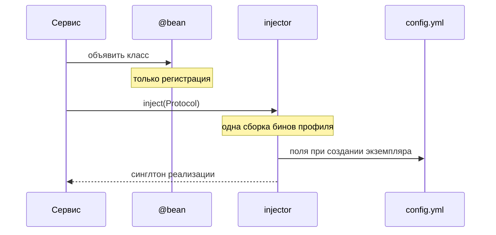

## Описание

`pyioc` (`mybootstrap_ioc_itskovichanton`) — IoC в духе Spring поверх opyoid. Декоратор `@bean` помечает класс, подставляет поля из `config.yml` по профилю `dev` или `prod` и регистрирует реализацию на Protocol. `injector()` отдаёт синглтоны остальным пакетам каркаса. Это сборка объектов, а не слой данных.

## Процедуры БД

Процедур базы данных нет. `nested_dict_iter` обходит словари конфигурации и к базе не относится.

## Схема работы

## Сценарии

### Регистрация бина и получение синглтона

1. Сервис помечает класс декоратором `@bean`. Реализация регистрируется на Protocol. Контейнер при этом не собирается.
2. Сервис вызывает `injector().inject(Protocol)`. Граф бинов текущего профиля `dev` или `prod` строится один раз.
3. Поля вида `("dotted.path", Type)` читаются из уже загруженного `config.yml` в момент создания экземпляра.
4. Инжектор возвращает синглтон реализации. Следующий бин или смена профиля помечают контейнер к одной повторной сборке, а не к сборке на каждый класс.

# ioc

spring-like IOC implementation